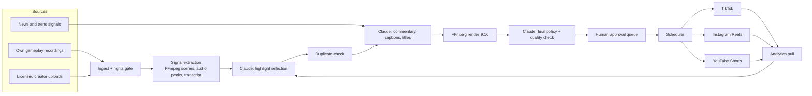

# GTA 6 short-form media engine: architecture, budget and setup plan

Status: plan only. Nothing here has been deployed, purchased or signed up for.
Written 10 November 2026.

## 1. What this is

A pipeline that turns licensed GTA gameplay footage into five original short
videos a day and publishes each one to TikTok, Instagram Reels and YouTube
Shorts (15 posts a day), then learns from the results.

- **Brain:** Claude API (picks highlights, writes commentary and captions, checks policy).
- **Conductor:** n8n (schedules and connects every step).
- **Editor:** FFmpeg (cuts, reframes to 9:16, burns captions, mixes voice).
- **Publishing:** the official TikTok, Instagram and YouTube APIs only.

Testing starts with GTA 5 footage. The same pipeline switches to GTA 6 by
changing one setting (`game = gta6`) and the source list.

## 2. Four things to know before anything else

1. **The launch is closer than the approvals.** Rockstar's announced date is
   19 November 2026, nine days from today (I could not find news from the last
   few months confirming or moving it; check Rockstar's own channels). TikTok
   and YouTube both hold API uploads **private** until they have audited the
   app, and those audits take weeks. So automated *public* posting will
   probably not be live on launch day. The realistic plan is: pipeline produces
   the clips from day one, a person posts them with the platforms' own
   scheduling tools until the audits clear, then n8n takes over.
2. **"Authorized creator content" has to mean a written licence.** A creator
   saying "sure" in a DM is not enough, and neither is crediting them. Reposting
   other people's clips, even with permission, is also exactly what YouTube's
   reused-content and inauthentic-content rules target. The plan therefore
   treats our own recorded gameplay as the main source and licensed creator
   footage as a supplement, always with real added commentary.
3. **Fully hands-off is the wrong target for the first weeks.** Channels that
   look mass-produced lose monetisation or get removed. The design keeps a
   one-tap human approval step during testing and removes it per platform only
   once quality is proven.
4. **Somebody still has to play the game.** GTA 6 launches on PS5 and Xbox
   Series X/S only, so own footage means a console and a capture device. The
   system automates everything after the recording lands in a folder.

## 3. Architecture

Everything hangs off one Postgres database and one file store. n8n never holds
state itself, so a failed step can be re-run safely.

### 3.1 Source discovery

Discovery finds **leads and topics**, never footage to grab.

| Source | How | What it produces |
|---|---|---|
| Own gameplay | Capture software saves to a watched folder that syncs to storage | Raw footage, rights already clear |
| Licensed creators | Each creator gets a private upload link; files arrive with their licence ID attached | Raw footage tied to a licence |
| Creator prospecting | YouTube Data API search for GTA channels, ranked by size and fit | A list of people to contact for a licence, not videos to download |
| Topics and trends | Rockstar Newswire, YouTube trending in Gaming, Reddit API | Daily topic list that steers which highlights and angles are chosen |

No downloading from YouTube, TikTok or Twitch with scraping tools. That breaks
their terms and would put the publishing accounts at risk.

### 3.2 Rights verification (fails closed)

A clip cannot be rendered or published unless every piece of it passes.

- **Rights ledger table:** one row per source with owner, licence type
  (own / written licence / Creative Commons), platforms covered, start and
  expiry dates, whether monetisation is allowed, credit wording, and a link to
  the signed document.
- **Gate 1, at ingest:** footage with no valid ledger row is quarantined.
- **Gate 2, before publish:** re-checks expiry and platform scope, because a
  licence can lapse between render and post.
- **Publisher rules (Rockstar / Take-Two):** their policy allows fans to post
  gameplay footage but restricts spoilers, cutscene-only videos, endings and
  leaked or pre-release material, and they can remove content case by case.
  Coverage of whether monetised use is allowed is inconsistent, so read the
  current policy page at launch and email copyright@take2games.com if unclear.
  Claude tags each candidate for story-spoiler and cutscene content and those
  are blocked by default.
- **Audio:** in-game radio is licensed music and triggers copyright claims.
  Record with radio off, and the render step drops game music where detected.
- **Takedown path:** one n8n workflow removes a clip from all three platforms
  and marks the source as blocked.

### 3.3 Highlight selection

Claude does not take video files, so the pipeline turns video into things it
can read:

1. **Cheap signals, no AI:** FFmpeg scene-change detection, audio loudness
   peaks, and a transcript with timestamps (self-hosted Whisper).
2. **Triage:** each candidate window (transcript plus four frames) is scored by
   Claude for hook strength, clarity without context, and policy flags.
3. **Final pick:** the best 10 to 15 go back with denser frames; Claude chooses
   five, sets exact in and out points, and explains why. Yesterday's best and
   worst performers are included as examples so selection improves over time.

All Claude answers come back as structured JSON so n8n can act on them directly.

### 3.4 Original commentary and captions

- Claude writes a short script per clip in one consistent channel voice: a
  hook in the first two seconds, an actual opinion or piece of context, a
  closing line. This is the "added value" the platforms require.
- **Voice:** best option is the owner recording the lines (two minutes a day);
  next best is one licensed synthetic voice used consistently. Synthetic voice
  is disclosed with each platform's AI-content label.
- **Captions:** word-timed subtitles burned into the video, plus a title,
  description and hashtags written separately for each platform.

### 3.5 Video editing (FFmpeg)

One render template, driven by a JSON edit list: cut, reframe 16:9 to 9:16
(crop that follows the action, with a blurred fill as fallback), loudness
normalisation, voice mixed over ducked game audio, burned captions, 1080x1920
H.264 output. Each platform gets its own file so intros and safe areas can
differ slightly.

### 3.6 Duplicate prevention

| Layer | Catches |
|---|---|
| Source time-range overlap | The same moment being cut twice |
| Perceptual video hash on keyframes | The same visuals from a different file or creator |
| Audio fingerprint | Re-used voice or audio |
| Text similarity on scripts and titles | Repeating the same joke or angle |
| Unique key on (clip, platform) | The same clip posting twice after a retry |

### 3.7 Scheduling and publishing

Five slots per platform per day, with times that start from sensible defaults
and shift toward whatever the analytics show works.

| Platform | API | Limits that matter | Approval needed |
|---|---|---|---|
| YouTube Shorts | YouTube Data API `videos.insert` | Default upload quota is plenty for 5 a day (the quota model changed in the last year; confirm in the Cloud Console) | Uploads from an unaudited project are locked private; request the compliance audit |
| Instagram Reels | Instagram content publishing API | 50 to 100 API posts per 24h (Meta's docs give both; the account's own limit endpoint is the truth). Video must sit at a public URL. Upload containers expire after 24h, so schedule in our own database | Professional account. Posting to our own account works while the app is in development mode |
| TikTok | Content Posting API (direct post) | Unaudited apps can only post privately | App review, then a separate content-posting audit |

### 3.8 Analytics

A nightly workflow pulls views, watch time, retention, likes, shares and
follower change from YouTube Analytics, Instagram insights and TikTok's
display API into Postgres. A small dashboard (Metabase) shows performance by
clip, hook type, topic and posting time. The top and bottom clips feed back
into the selection prompt, and a weekly Claude summary says what to do more of.

### 3.9 n8n workflows

1. Ingest and rights gate (on new file)
2. Signal extraction (queue worker)
3. Select, script and render (daily, early morning)
4. Approval queue (Telegram or Slack buttons)
5. Publisher (every 15 minutes, posts what is due)
6. Analytics pull (nightly)
7. Trend and topic scan (every few hours)
8. Creator prospecting (weekly)
9. Takedown (manual trigger)
10. Health check and alerts (failed posts, expiring licences, expiring tokens)

### 3.10 Built to scale for launch

- n8n runs in queue mode, so heavy work (transcription, rendering) is done by
  worker containers that can be multiplied by adding servers for launch month
  and removed afterwards.
- Storage is object storage with no download fees, so volume does not surprise.
- The game is a setting, not code: prompts, spoiler rules and source lists are
  per game.
- More output should come from more formats and languages (Spanish, Portuguese,
  Arabic), not from pushing more near-identical clips per account, which reads
  as spam.
- A launch-week mode shortens the cycle from daily to every few hours and
  raises the spoiler filter to maximum.

## 4. Budget

Estimates, in US dollars. Vendor prices should be re-checked before buying.

### Monthly running cost

| Item | Testing (GTA 5) | Launch scale | Notes |
|---|---|---|---|
| Claude API | $50 to $90 | $150 to $300 | About 400k input and 45k output tokens a day on Claude Opus 5.5 ($4 / $20 per million). Using Claude Haiku 5.5 for the triage step and the batch API (half price) for non-urgent work roughly halves this |
| Server for n8n, Postgres, FFmpeg | $20 to $40 | $80 to $150 | One 4 to 8 core VPS; add render workers for launch |
| n8n | $0 | $0 | Self-hosted community edition. n8n Cloud is the paid alternative at roughly $25 to $60 |
| Storage | $3 to $10 | $15 to $40 | About 200 GB to 1 TB |
| Transcription | $0 | $0 | Self-hosted Whisper on the same server |
| Voice | $0 to $25 | $0 to $100 | $0 if the owner records; otherwise a synthetic voice plan |
| Music and sound effects licence | $0 to $15 | $15 | Optional |
| Domain and policy pages | $1 | $1 | Needed for the platform app reviews; can live in this repo on Vercel |
| Platform APIs | $0 | $0 | All three are free |
| **Total** | **about $75 to $180** | **about $260 to $600** | |

### One-time cost

| Item | Cost | Notes |
|---|---|---|
| GTA 6 | about $70 to $80 | |
| Console | $0 to $500 | If not already owned |
| Capture card | $120 to $200 | For clean recording without game music |
| Licence template reviewed by a lawyer | $300 to $800 | Strongly advised before using anyone else's footage |
| **Total** | **about $500 to $1,600** | |

### Income, honestly

Short-form pays little per view. YouTube Shorts ad share and TikTok's creator
programme both have entry thresholds and both exclude unoriginal content.
Expect the first months to cost money; sponsorships and a long-form channel are
where a gaming media brand usually earns.

## 5. Setup plan

Nothing in this section has been started.

**Phase 0: decisions and paperwork (days 1 to 3, no spend)**
- Pick the brand name and create the three channel accounts by hand.
- Start the slow approvals immediately: TikTok developer app and audit, Google
  Cloud project and YouTube API audit, Meta developer app.
- Publish a privacy policy and terms page (the reviews require them).
- Read Rockstar's current content policy and note the GTA 6 specifics.
- Draft the creator licence template.

**Phase 1: build with GTA 5, publish nothing (weeks 1 to 2)**
- Stand up the server, n8n, Postgres and storage.
- Build ingest, rights ledger, signal extraction, Claude selection, render.
- Target: five finished clips a day landing in a review folder.

**Phase 2: private testing (weeks 2 to 4)**
- Connect the three APIs and post as private or unlisted.
- Turn on the approval queue, duplicate checks and analytics pull.
- Until the audits clear, post approved clips with each platform's own
  scheduler so the channels are active for launch.

**Phase 3: public and learning (once audits clear)**
- Switch publishing to automatic for approved clips.
- Turn on the analytics feedback loop and weekly review.
- Sign the first two or three creator licences.

**Phase 4: GTA 6 (from launch)**
- Switch the game setting, add render workers, enable launch-week mode.
- Hold the approval step for launch month; spoiler mistakes are costly.

### Go / no-go checks before removing the human approval step

- 14 days in a row with no rights, spoiler or policy misses.
- No copyright claims or platform warnings.
- Fewer than one in ten clips rejected by the reviewer.

## 6. Decisions needed from the owner

1. Who records the gameplay, and on which console?
2. Own voice or synthetic voice for commentary?
3. Self-hosted n8n (cheaper, some upkeep) or n8n Cloud (simpler, monthly fee)?
4. Monthly budget ceiling for the test phase.
5. English only at first, or more languages from the start?

## Sources checked

- [GamesRadar: GTA 6 everything we know](https://www.gamesradar.com/gta-6-release-date-news-trailers-map-gameplay-rumours/)
- [Gameluster: GTA 6 still targeting November 19, 2026](https://gameluster.com/gta-6-release-date-2/)
- [Rockstar: policy on posting copyrighted material](https://support.rockstargames.com/articles/200153756/rockstar-games-video-policy)
- [TikTok: content sharing guidelines](https://developers.tiktok.com/doc/content-sharing-guidelines)
- [TikTok: direct post API reference](https://developers.tiktok.com/doc/content-posting-api-reference-direct-post)
- [Google: YouTube Data API quota costs](https://developers.google.com/youtube/v3/determine_quota_cost)
- [Meta: Instagram content publishing](https://developers.facebook.com/docs/instagram-platform/content-publishing)
- [vidIQ: YouTube reused content policy](https://vidiq.com/blog/post/youtube-reused-content-policy-guide/)
- [Net Influencer: YouTube inauthentic content clarification](https://www.netinfluencer.com/youtube-clarifies-july-15-policy-update-repetitious-content-rebranded-as-inauthentic-content/)
